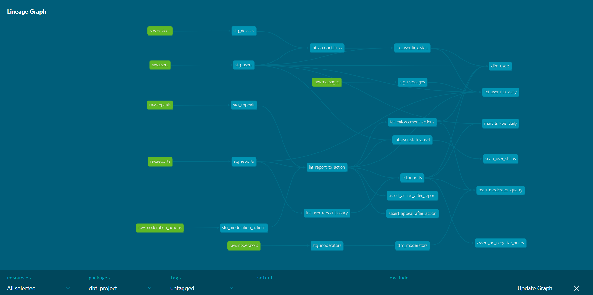

# Trust & Safety Analytics: Abuse Detection, Moderation Quality & Operational Intelligence

An end-to-end analytics engineering project exploring coordinated account abuse, moderation quality, enforcement outcomes, and platform safety operations using SQL, dbt, DuckDB, and Python.

## Executive Summary

This project builds a modular Trust & Safety analytics pipeline to transform raw platform activity into actionable operational intelligence.

Using a synthetic dataset of 20,000 users, the pipeline identifies coordinated account networks, evaluates moderator enforcement quality, and monitors moderation performance through analytical marts and KPI reporting.

**Key findings:**
- Identified all 40 deliberately planted coordinated-ring accounts, with no false positives in the synthetic validation dataset.
- Identified a moderator with a 9.40% appeal overturn rate, compared with 2.31% across other moderators pooled.
- Detected a 50.6% increase in mean daily median moderation action time after the simulated policy-change date.
- Found that exposure-normalised reporting rates remained broadly stable despite a substantial increase in raw report volume.

> This project uses synthetic data and simulated patterns. Results demonstrate analytical methodology, not production detection performance.

## Business Problems

Trust & Safety teams face several interconnected challenges:

1. **Coordinated abuse:** How can potentially related accounts be identified through shared devices, signup IPs, and behavioural signals?
2. **Moderation quality:** Are enforcement decisions consistent, and do appeal overturns reveal potential quality issues?
3. **Operational efficiency:** Are reports being actioned within SLA, and are moderation queues becoming slower?
4. **Platform health:** Are changes in report volume driven by user behaviour or simply increased platform activity?

## Data Architecture

The project follows a layered dbt architecture:

| Layer | Purpose |
|---|---|
| Raw sources | Synthetic platform, user, device, report, moderation and appeal data |
| Staging | Standardisation, type casting, and sensitive identifier hashing |
| Intermediate | Account linking, report history, and report-to-action transformations |
| Marts | Analytical facts, dimensions, moderator quality, and operational KPIs |

### dbt Lineage Graph



The lineage graph illustrates the dependencies between source data, transformation models, analytical marts, and data-quality tests.

## Key Analytical Findings

### 1. Coordinated Account Detection

The account-linking pipeline combines shared device identifiers and hashed signup IPs to identify potentially related accounts.

| Metric | Result |
|---|---:|
| Planted ring accounts | 40 |
| Correctly flagged | 40 |
| False positives | 0 |
| False negatives | 0 |
| Precision | 100% |
| Recall | 100% |

These results are based on deliberately planted patterns in a synthetic dataset.

**Business implication:** Multi-signal account linking can help prioritise suspicious account clusters for investigation. Shared IPs and devices should not independently trigger enforcement because legitimate users may share them.

### 2. Moderation Quality Analysis

Moderator 7 showed a substantially higher appeal overturn rate than the other moderators pooled.

| Metric | Moderator 7 | Other moderators |
|---|---:|---:|
| Enforcement actions | 1,390 | 9,684 |
| Overturned actions | 130 | 224 |
| Overturn rate | 9.40% | 2.31% |

Moderator 7's overturn rate was approximately **4.1 times higher**, with an absolute difference of 7.09 percentage points.

The approximate 95% confidence interval for Moderator 7's overturn rate was 7.87%–10.93%.

**Business implication:** This warrants a deeper quality investigation, including case complexity, policy-category mix, assignment patterns, and enforcement consistency. A higher overturn rate alone does not establish poor moderator performance.

### 3. Reporting Trends and Operational Performance

A before-and-after comparison around the simulated policy-change date (August 15, 2026) revealed an important distinction between raw volume and exposure-normalised reporting.

| Metric | Before | After |
|---|---:|---:|
| Average daily reports | 91 | 213 |
| Messages | 51,529 | 124,603 |
| Reports per 1,000 messages | 80.36 | 79.93 |
| Mean daily median action time | 7.9 hours | 11.9 hours |

**Key observations:**
- Daily report volume increased by approximately 134%.
- Reports per 1,000 messages decreased by approximately 0.54%.
- Mean daily median moderation action time increased by approximately 50.6%.

**Business implication:** Raw report volume can be misleading when platform activity is growing. Exposure-normalised metrics provide better context, while increasing action times may indicate operational pressure or reduced queue efficiency.

These are simulated before-and-after observations, not evidence of causation.

## Technology Stack

| Technology | Application |
|---|---|
| SQL | Data transformations and analytical queries |
| dbt Core | Modular transformation architecture and testing |
| DuckDB | Local analytical database |
| Python | Synthetic data generation and validation |
| pandas | Data analysis |
| GitHub | Version control and collaboration |
| GitHub Actions | Automated CI pipeline |

## Data Quality and CI/CD

The project incorporates automated data quality checks and continuous integration.

- 52 dbt data tests.
- Source definitions and model documentation.
- Unique, not-null, accepted-value, and relationship tests.
- Custom SQL assertions for temporal consistency and negative action times.
- GitHub Actions workflow triggered by pushes to `main` and pull requests.
- Automated synthetic data generation and `dbt build` validation.

**CI status:** See the badge at the top of this README.

## Repository Structure

```text
ts-analytics/
│
├── .github/
│   └── workflows/
│       └── ci.yml
│
├── analysis/
│   ├── findings.md
│   ├── check_findings.py
│   └── check_moderator.py
│
├── data/
│   ├── raw/
│   └── answer_key/
│
├── data_gen/
│
├── dbt_project/
│   ├── models/
│   │   ├── staging/
│   │   ├── intermediate/
│   │   └── marts/
│   ├── tests/
│   ├── macros/
│   ├── snapshots/
│   ├── seeds/
│   ├── dbt_project.yml
│   ├── packages.yml
│   └── profiles.yml
│
├── docs/
│   └── lineage.png
│
├── requirements.txt
└── README.md
```

Raw synthetic data and answer-key files are generated locally and excluded from version control.

## Running the Project Locally

### 1. Clone the repository

```bash
git clone https://github.com/anuska-mukherjee/ts-analytics.git
cd ts-analytics
```

### 2. Create and activate a Python environment

```bash
python -m venv .venv
```

Windows PowerShell:

```powershell
.\.venv\Scripts\Activate.ps1
```

### 3. Install dependencies

```bash
pip install -r requirements.txt
```

### 4. Generate synthetic data

```bash
python -m data_gen.gen_users
python -m data_gen.gen_activity
```

### 5. Build the dbt project

```bash
cd dbt_project
dbt deps
dbt build
```

The dbt profile is configured for a local DuckDB database. For a different environment, configure the appropriate profile and database path.

## Limitations

- Synthetic data cannot represent the full complexity of real-world abuse.
- Planted-pattern detection results should not be interpreted as production model performance.
- Shared device and IP signals can generate legitimate account associations.
- Before-and-after comparisons do not establish causality.
- Moderator overturn rates require case-mix adjustment and contextual review.

## Future Enhancements

1. **Account risk scoring:** Develop a supervised or graph-based model to prioritise suspicious account clusters.
2. **LLM-assisted report triage:** Experiment with report classification, evidence extraction, and policy recommendation with human review.
3. **Moderator quality monitoring:** Add case-mix-adjusted comparisons and category-level overturn analysis.
4. **Operational anomaly detection:** Introduce rolling averages, queue backlog monitoring, and SLA anomaly alerts.
5. **Interactive dashboard:** Build a Streamlit dashboard for investigation metrics, moderator quality, and platform health.

---

**Project focus:** Trust & Safety Analytics · Abuse Detection · Moderation Operations · Analytics Engineering · Product Analytics

[GitHub Repository](https://github.com/anuska-mukherjee/ts-analytics)